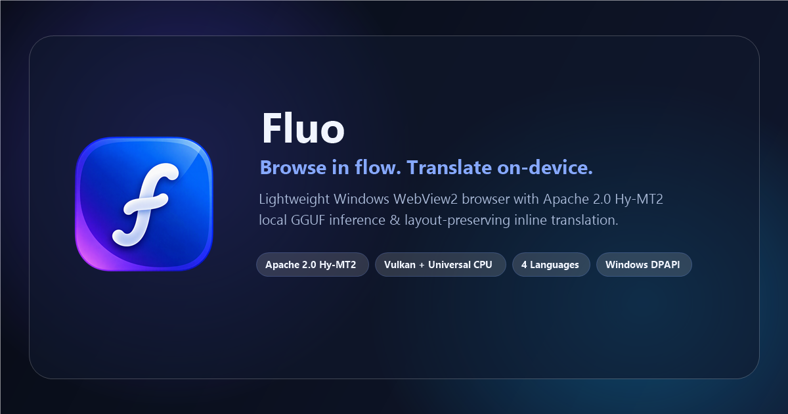

  

  
  
  
  
  

[English](./README.md) · [한국어](./README.ko.md) · [日本語](./README.ja.md) · [简体中文](./README.zh-CN.md) · [利用規約](./TERMS_OF_USE.md) · [ライセンスとモデルポリシー](./THIRD_PARTY_LICENSES.md)

# Fluo — *Browse in flow. Translate on-device.*
> **途切れない流れで閲覧し、デバイス上で瞬時に翻訳。**

> 🌐 **公式プロジェクトページ（4言語対応）:** https://apple-out.github.io/transratebrowser/  
> 📦 **Windows オープンベータダウンロード:** https://github.com/apple-out/transratebrowser/releases  
> 🐞 **バグ・誤訳レポート (GitHub Issues):** https://github.com/apple-out/transratebrowser/issues/new/choose

**Fluo** *(エスペラント語で「流れ・流暢さ」)* は、Windows ネイティブ WebView2 をベースに、量子化 Apache 2.0 GGUF ローカル LLM (`Hy-MT2` / `llama.cpp` + Vulkan) とクラウド AI（**Google Gemini**、**OpenAI 互換 API**、**OpenAI レガシー / ChatGPT OAuth**、**ローカルブリッジ**）を統合した高速オンデバイス翻訳ブラウザです。

技術ドキュメントや海外 Wiki、Web 小説のリンク・装飾・コードを崩さずその場で自然に翻訳し、**初回起動時の言語選択**、**4 言語 UI リアルタイム切替（日本語 / 한국어 / English / 简体中文）**、**あらゆる CPU＋GPU 環境での自動アクセラレーション**を備えています。

---

## 主な特徴

- **初回言語選択＆ 4 言語 UI 切替:** 初回起動時に表示言語と翻訳先言語を選択でき、**メニュー（⋯）** や **設定 → 外観・言語** からいつでも即時に切り替えられます。
- **オフライン・オンデバイス翻訳 (`Hy-MT2`, Apache 2.0)＋ユニバーサルハードウェア最適化:**
  - API 料金不要・外部送信なしのローカル GGUF 推論に対応。
  - **Vulkan GPU アクセラレーション:** **NVIDIA (GeForce/RTX)**、**AMD (Radeon / Ryzen iGPU ハイブリッド層分割)**、**Intel (Arc / Iris Xe)** に広く対応。
  - **ユニバーサル動的 CPU バックエンド (`GGML_BACKEND_DL=ON` + `GGML_CPU_ALL_VARIANTS=ON`):** `AVX-512` / `AVX2` / `AVX` / `SSE4.2` / `x64` DLL を同梱し、実行環境の CPU＋GPU に最適なバックエンドを自動選択します。
- **レイアウト保持インライン翻訳:** リンクやコードスパンを維持したまま翻訳。原文・訳文並列表示、**領域選択翻訳**、右クリック選択翻訳、文体自動判定（`auto` / `natural` / `novel` / `literal` / `polished`）、用語集を搭載。
- **実用ブラウザ機能:** 非同期ワークスペース管理、タブスリープ省メモリ、サイト別 AdBlock 例外、ポップアップ制御、Chrome/Edge ブックマーク・履歴・パスワード CSV インポート。
- **Windows DPAPI 暗号化保管庫＆端末間同期:** API キーや保存パスワードは Windows DPAPI でローカル暗号化され、同期ファイルには含まれません。Google Drive / OneDrive / 任意フォルダ同期に対応。
- **無制限オープンベータ・フィードバック:** 個人メールアドレスを公開せず、**GitHub Issues ワンクリック作成**や任意の **Cloudflare Workers (`*.workers.dev`)** 匿名リレーを通じてバグや誤訳を無制限に報告できます。

---

## クイックスタート (Windows 10 / 11 x64)

1. [GitHub Releases](https://github.com/apple-out/transratebrowser/releases) から `Fluo-v0.1.0-win64.zip` をダウンロードします。
2. 任意のフォルダーに展開し、`Fluo.exe` を起動します（同梱の `llama.dll`・`ggml*.dll`・MSVC ランタイム DLL は同じフォルダーに置いたままにしてください）。
3. 初回起動の言語選択で言語を選んだ後、**翻訳 ▾ → 推奨モデルのダウンロード** で即座にオフライン翻訳を開始できます。

利用規約（OpenAI レガシー / ChatGPT OAuth `codexLegacy` の注意事項を含む）は [TERMS_OF_USE.md](./TERMS_OF_USE.md)、依存パッケージと Apache 2.0 モデルポリシーの詳細は [THIRD_PARTY_LICENSES.md](./THIRD_PARTY_LICENSES.md) をご覧ください。

## ライセンス

[MIT License](./LICENSE)
