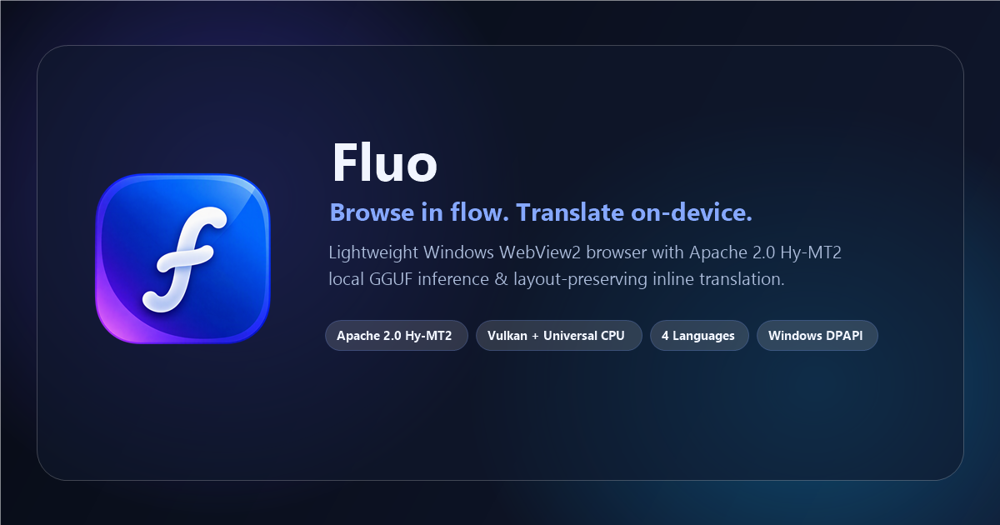

  

  
  
  
  
  

[English](./README.md) · [한국어](./README.ko.md) · [日本語](./README.ja.md) · [简体中文](./README.zh-CN.md) · [이용 약관](./TERMS_OF_USE.md) · [오픈소스 및 모델 라이선스](./THIRD_PARTY_LICENSES.md)

# Fluo — *Browse in flow. Translate on-device.*
> **막힘없는 흐름으로 탐색하고, 기기에서 즉시 번역하다.**

> 🌐 **공식 프로젝트 페이지 (4개국어):** https://apple-out.github.io/transratebrowser/  
> 📦 **Windows & iOS 오픈 베타 다운로드:** https://github.com/apple-out/transratebrowser/releases  
> 🐞 **무제한 버그 · 오역 제보 (GitHub Issues):** https://github.com/apple-out/transratebrowser/issues/new/choose

**Fluo**(에스페란토로 *‘흐름 · 유창함’*)는 **Windows 네이티브 WebView2** 및 **iOS WKWebView (Apple 공식 iOS 26 Liquid Glass UI)** 위에 양자화 Apache 2.0 GGUF 로컬 AI 모델(`Hy-MT2` · `llama.cpp` + Vulkan / Metal / CPU)과 클라우드 AI(**Google Gemini**, **OpenAI 호환 API**, **OpenAI 레거시 / ChatGPT OAuth**, **로컬 브리지**)를 결합한 **온디바이스 인라인 번역 브라우저**입니다.

게임 위키·기술 문서·웹소설의 링크와 서식을 깨뜨리지 않고 본문 자리에 자연스럽게 번역을 덧입히며, **최초 실행 언어 선택**, **4개국어(한국어 / English / 日本語 / 简体中文) UI 즉시 전환**, **모든 CPU · GPU 조합 자동 가속**을 지원합니다.

---

## 주요 기능

- **최초 실행 언어 선택 & 4개국어 즉시 전환:** 첫 실행 시 인터페이스 언어와 기본 번역 언어를 한 번에 선택할 수 있으며, 이후에도 **`⋯` 메뉴** 또는 **설정 → 모양 · 언어**에서 언제든 즉시 바꿀 수 있습니다.
- **오프라인 온디바이스 AI (`Hy-MT2` · Apache 2.0) + 범용 하드웨어 가속:**
  - API 비용·외부 전송 걱정 없이 PC 안에서 무료로 동작하는 로컬 GGUF 추론 지원.
  - **Vulkan GPU 가속:** **NVIDIA GeForce/RTX**, **AMD Radeon/Ryzen iGPU 하이브리드 레이어 분할**, **Intel Arc/Iris Xe** 모두 지원.
  - **범용 동적 CPU 백엔드 (`GGML_BACKEND_DL=ON` · `GGML_CPU_ALL_VARIANTS=ON`):** `AVX-512`, `AVX2`, `AVX`, `SSE4.2`, 기본 `x64` DLL을 동시 탑재해 어떤 CPU·GPU 조합에서도 런타임에 최적 명령어를 자동 선택합니다.
- **레이아웃 유지 인라인 번역 & 자동화:** 링크·코드·배지·서식을 유지한 채 본문 문단을 제자리에서 번역합니다. **외국어 페이지 자동 감지 & 사이트별 '항상 자동 번역'**, **무한 스크롤(MutationObserver) 실시간 이어서 번역**, **소리 내어 읽기(TTS / Read Aloud + 문단 하이라이트)**, 원문/번역 동시 보기, **영역 선택 번역(Region Picker)**, 드래그·우클릭 즉시 번역, 문체 자동 판별(`auto`, `natural`, `novel`, `literal`, `polished`), 폴더형 정규식/CSV 용어집을 지원합니다.
- **데스크톱 & 모바일(iOS 26 Liquid Glass) 완성도:** 프리징 없는 비동기 작업공간(Workspace) 전환·생성·삭제, 절전 탭 메모리 절약, 주소창 수식 계산기(`= 1024*64`)·열린 탭 전환·키워드 검색(`@namu`, `@naver`, `@yt`), 커스텀 시작 페이지(`tb://start` / `fluo://start`), 한국어+글로벌 50+ 도메인 AdBlock 및 코스메틱 필터, 북마크·방문·번역 기록·다운로드 관리.
- **Windows DPAPI 로컬 암호화 금고 & 동기화:**
  - API 키·OAuth 토큰·저장된 비밀번호는 Windows `CryptProtectData`(DPAPI)로 암호화되어 로컬에만 저장되며 동기화 파일에 포함되지 않습니다.
  - **Google Drive**, **OneDrive** 또는 **사용자 지정 폴더**(Dropbox, NAS 등)를 통해 삭제 부활 현상 없는 장치 간 병합 동기화를 지원합니다.
- **제한 없는 오픈 베타 피드백 시스템:**
  - 개인 이메일 노출이나 일일 발송 제한(100통/일) 없이 앱 내 **`⋯` → 버그 · 불편 · 번역 오류 제보**에서 **GitHub Issues 1클릭 사전 입력 제보** 및 진단 정보 복사/내보내기를 지원합니다.
  - 필요 시 하루 10만 건 무료인 **Cloudflare Workers (`*.workers.dev`)** 익명 릴레이를 연결할 수 있습니다([가이드](./scripts/FEEDBACK_RELAY_GUIDE.md)).

---

## 빠른 시작 (Windows 10 / 11 x64 & iOS 16–26+)

### Windows 10 / 11 (x64)
1. [GitHub Releases](https://github.com/apple-out/transratebrowser/releases)에서 최신 포터블 ZIP(`Fluo-v0.1.0-win64.zip`)을 내려받습니다.
2. 압축을 푼 뒤 폴더 안의 **`Fluo.exe`** 를 실행합니다.
   - 함께 포함된 `llama.dll`, `ggml*.dll`, VC++ 런타임 DLL 파일들이 같은 폴더에 있어야 범용 CPU 및 Vulkan GPU 가속이 정상 동작합니다.
3. 첫 실행 언어 선택에서 언어를 고른 뒤 상단 **`번역 ▾` → 권장 모델 다운로드**(`Hy-MT2-1.8B`, Apache 2.0)를 누르면 바로 오프라인 번역을 시작할 수 있습니다.

### iOS / iPhone (iOS 16–26+ · 공식 Liquid Glass UI)
1. [GitHub Releases](https://github.com/apple-out/transratebrowser/releases) 또는 `release-tester/Fluo-iOS-v0.1.0-unsigned.ipa`에서 무서명 IPA를 내려받습니다.
2. **Sideloadly**, **AltStore**, 또는 **SideStore**를 사용해 본인 Apple ID로 서명하여 iPhone에 설치합니다.
3. 앱 내 **설정 → 온디바이스 모델 관리**에서 iPhone RAM에 최적화된 2-Bit(572MB) 또는 1.25-Bit `Hy-MT2` 모델을 내려받거나 Gemini/OpenAI API 키(iOS Keychain 암호화)를 연결해 즉시 번역을 사용할 수 있습니다.

## 이용 약관 · 오픈소스 & 모델 정책

이용 약관(선택적 OpenAI 레거시 / ChatGPT OAuth `codexLegacy` 연결 고지 포함)은 [TERMS_OF_USE.md](./TERMS_OF_USE.md), 의존 크레이트·npm 패키지·상업적 허용 Apache 2.0 `Hy-MT2` 모델 라이선스 상세 내역은 [THIRD_PARTY_LICENSES.md](./THIRD_PARTY_LICENSES.md), 보안 제보는 [SECURITY.md](./SECURITY.md)를 참고해 주세요.

## 라이선스

[MIT License](./LICENSE)
