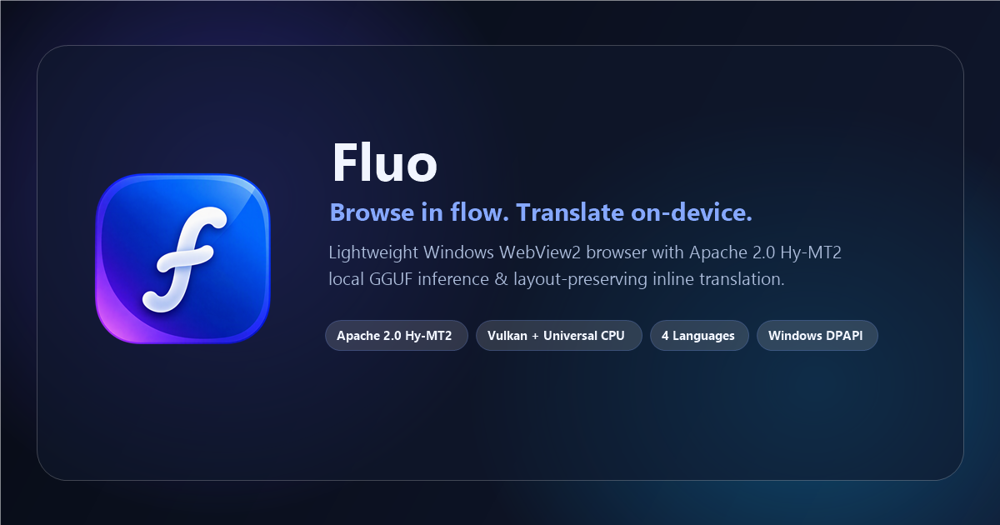

<p align="center">
  <a href="https://apple-out.github.io/transratebrowser/">
    
  </a>
</p>

<p align="center">
  <a href="https://github.com/apple-out/transratebrowser/releases/latest"></a>
  <a href="https://github.com/apple-out/transratebrowser/releases"></a>
  <a href="./LICENSE"></a>
  
  <a href="./THIRD_PARTY_LICENSES.md"></a>
</p>

[English](./README.md) · [한국어](./README.ko.md) · [日本語](./README.ja.md) · [简体中文](./README.zh-CN.md) · [Terms of Use](./TERMS_OF_USE.md) · [Open-Source & Model Licenses](./THIRD_PARTY_LICENSES.md)

# Fluo — *Browse in flow. Translate on-device.*

> 🌐 **Official Website (4 Languages):** https://apple-out.github.io/transratebrowser/  
> 📦 **Download Windows & iOS Open Beta:** https://github.com/apple-out/transratebrowser/releases  
> 🐞 **Unlimited Bug & Translation Reports:** https://github.com/apple-out/transratebrowser/issues/new/choose

**Fluo** *(Esperanto for "flow / fluency")* is a lightweight **Windows WebView2** and **iOS WKWebView (Apple's official iOS 26 Liquid Glass UI)** browser with **on-device AI inline translation** powered by quantized Apache 2.0 GGUF models (`Hy-MT2` via `llama.cpp` + Vulkan / Metal / CPU) alongside optional cloud APIs (**Google Gemini**, **OpenAI-compatible**, **OpenAI Legacy / ChatGPT OAuth**, and **Local Bridge**).

Designed for reading long technical wikis, web fiction, and multilingual pages directly in place without layout breakage — featuring a **first-run 4-language picker**, **4 switchable interface languages** (**한국어 / English / 日本語 / 简体中文**), and **universal GPU + CPU acceleration**.

---

## Key Highlights

- **First-Run 4-Language Picker & Instant UI Switching:** Prompts new users to pick their preferred display & target translation language on first launch (changeable anytime from **Menu (⋯)** or **Settings → Appearance · Language**) across **한국어**, **English**, **日本語**, and **简体中文**.
- **On-Device Offline AI (`Hy-MT2`, Apache 2.0) + Universal Hardware Dispatch:**
  - Runs locally with **zero API fees** and **zero cloud prompts**.
  - **Vulkan GPU acceleration** across **NVIDIA (GeForce/RTX)**, **AMD (Radeon / Ryzen iGPU Hybrid Layer Split)**, and **Intel (Arc / Iris Xe)**.
  - **Universal dynamic CPU backend** bundling `AVX-512`, `AVX2`, `AVX`, `SSE4.2`, and `x64` variants (`GGML_BACKEND_DL=ON` + `GGML_CPU_ALL_VARIANTS=ON`) — automatically picking the fastest instruction set at runtime on any CPU + GPU combination.
- **Format-Preserving Inline Translation & Automation:** Translates paragraphs directly inside pages while preserving links, inline code spans, badges, tooltips, and interactive controls. Includes **foreign-page auto-detection & per-site 'Always Translate' rules**, **infinite-scroll (`MutationObserver`) live translation**, **Read Aloud (TTS) with active paragraph highlighting**, bilingual comparison mode, **click-to-translate region picker**, floating selection quick-translate chip, style auto-detection (`auto`, `natural`, `novel`, `literal`, `polished`), and folder-organized regex/CSV custom glossaries.
- **Full Desktop & Mobile (iOS 26 Liquid Glass) Ergonomics:** Non-blocking Workspaces with per-workspace tabs, sleeping tabs, omnibox math calculator (`= 1024*64`), switch-to-tab & keyword search (`@namu`, `@naver`, `@yt`), customizable Start Page (`tb://start` / `fluo://start`), 50+ domain AdBlock with cosmetic CSS filters, popup guard, bookmarks, downloads, and find-in-page.
- **Windows DPAPI Vault & Cross-Device Sync:**
  - API keys, OAuth tokens, and saved website logins are encrypted at rest via Windows `CryptProtectData` (DPAPI) and are **never** written to plaintext sync snapshots.
  - Optional merge-safe sync via **Google Drive**, **OneDrive**, or any **custom folder** (Dropbox, Syncthing, NAS) with per-device tombstones so deletions do not resurrect.
- **Unlimited Open Beta Feedback:**
  - Integrated 1-click **GitHub Issues** composer with pre-filled category (`Bug`, `UX`, `Translation Error`), Markdown export, and privacy-sanitized diagnostics.
  - Supports self-hosted **Cloudflare Workers (`*.workers.dev`)** relays (100,000 requests/day free) with zero exposed maintainer email addresses.

---

## Quick Start (Windows 10 / 11 x64 & iOS 16–26+)

### Windows 10 / 11 (x64)
1. Download the latest portable ZIP (`Fluo-v0.1.0-win64.zip`) from [GitHub Releases](https://github.com/apple-out/transratebrowser/releases).
2. Extract the archive and launch **`Fluo.exe`**.
   - Keep the bundled `.dll` files (`llama.dll`, `ggml*.dll`, MSVC runtime DLLs) in the same folder as `Fluo.exe` so universal CPU & Vulkan backends load cleanly.
3. Choose your preferred interface & target language on first launch, then click **`Translate ▾` → Download Recommended Model** (`Hy-MT2-1.8B`, Apache 2.0) for offline translation, or add an API key in **Settings → AI & Models**.

### iOS / iPhone (iOS 16–26+ · Official Liquid Glass UI)
1. Download `Fluo-iOS-v0.1.0-unsigned.ipa` from [GitHub Releases](https://github.com/apple-out/transratebrowser/releases) (or `release-tester/`).
2. Sideload onto your iPhone using **Sideloadly**, **AltStore**, or **SideStore** with your Apple ID.
3. In **Settings → On-Device Model Manager**, download the 2-Bit (572 MB) or 1.25-Bit `Hy-MT2` GGUF model (or configure a Gemini / OpenAI API key stored in iOS Keychain) and start translating inline.

---

## Building from Source

```powershell
# 1. Build frontend
cd tauri-app
npm install
npm run check
npm run build

# 2. Build universal-CPU + Vulkan backend release binary (in VS x64 Dev Prompt)
set GGML_BACKEND_DL=ON
set GGML_CPU_ALL_VARIANTS=ON
set CMAKE_GENERATOR=Ninja
set CL=/FS
npx tauri build --no-bundle --features vulkan,universal-cpu
```

See [TERMS_OF_USE.md](./TERMS_OF_USE.md) for usage terms (including the notice regarding optional OpenAI Legacy / ChatGPT OAuth `codexLegacy` connections), [THIRD_PARTY_LICENSES.md](./THIRD_PARTY_LICENSES.md) for audited dependency & Apache 2.0 AI model licensing, [scripts/FEEDBACK_RELAY_GUIDE.md](./scripts/FEEDBACK_RELAY_GUIDE.md) for optional Cloudflare Workers feedback relays, and [SECURITY.md](./SECURITY.md) for security reporting.

## License

Licensed under the [MIT License](./LICENSE).
